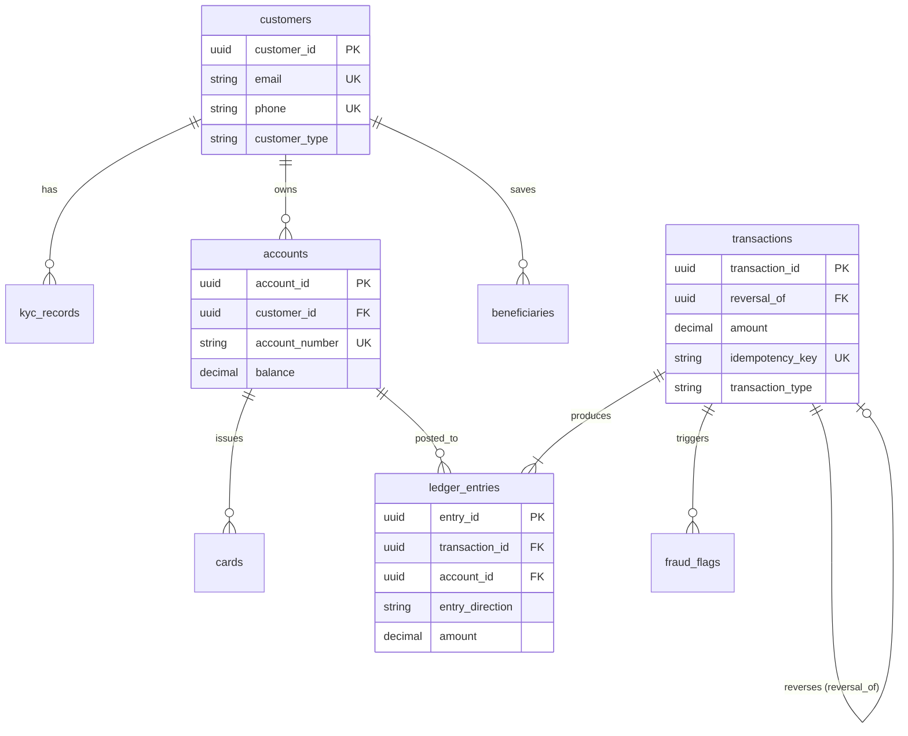

# Portfolio 1: Database Design & Relational Implementation

**Course**: MIT-8103: Advanced Database Systems  
**Module**: Continuous Assessment — Portfolio 1  
**Project**: QuickFund Digital Wallet & Financial Ledger System  
**Author**: [@tbalogun2815-source](https://github.com/tbalogun2815-source)  
**Database Engine**: PostgreSQL 15+ / 16+  

---

## 1. Executive Summary

Portfolio 1 delivers a robust, enterprise-grade relational database architecture for **QuickFund**, a simulated Nigerian digital wallet and money transfer fintech platform. The database model implements double-entry financial bookkeeping, strict multi-tier KYC compliance, PCI-DSS card security compliance, idempotency protection, and automated fraud flag monitoring.

The portfolio encompasses complete schema definitions (DDL), domain constraint assertions, a comprehensive normalisation and denormalisation report, an automated testing harness, and a high-performance deterministic data generator capable of seeding over 400,000 double-entry ledger lines within seconds.

---

## 2. Artifact Directory & File Catalog

All deliverables for Portfolio 1 are organized within this directory:

| Artifact | File Type | Description & Purpose |
| :--- | :--- | :--- |
| [00_create_database.sql](file:///c:/Users/DELL/Downloads/MIT-8103--Advanced-Database-CA/MIT-8103%20Advanced%20CA%20project/portfolio-1-database-design/00_create_database.sql) | SQL Script | Provisions the isolated `quickfund_db` database instance. |
| [case-study.md](file:///c:/Users/DELL/Downloads/MIT-8103--Advanced-Database-CA/MIT-8103%20Advanced%20CA%20project/portfolio-1-database-design/case-study.md) | Documentation | System background, user personas, 15 core business rules, entity catalog, and Mermaid ERD. |
| [create_tables.sql](file:///c:/Users/DELL/Downloads/MIT-8103--Advanced-Database-CA/MIT-8103%20Advanced%20CA%20project/portfolio-1-database-design/create_tables.sql) | DDL SQL Script | Creates the 8 core tables, UUID keys, domain `CHECK` constraints, unique constraints, and B-Tree indexes. |
| [constraint_tests.sql](file:///c:/Users/DELL/Downloads/MIT-8103--Advanced-Database-CA/MIT-8103%20Advanced%20CA%20project/portfolio-1-database-design/constraint_tests.sql) | Test SQL Script | Universal PL/pgSQL assertion suite testing 15 distinct boundary conditions, negative violations, and cascades. |
| [normalisation.md](file:///c:/Users/DELL/Downloads/MIT-8103--Advanced-Database-CA/MIT-8103%20Advanced%20CA%20project/portfolio-1-database-design/normalisation.md) | Technical Report | Rigorous 1NF–BCNF review detailing functional dependencies and justifying four deliberate 3NF trade-offs. |
| [seed_data.sql](file:///c:/Users/DELL/Downloads/MIT-8103--Advanced-Database-CA/MIT-8103%20Advanced%20CA%20project/portfolio-1-database-design/seed_data.sql) | Data Generator | Single-transaction set-based generator producing 5,001 customers, 6,001 accounts, ~200k transfers, and ~400k ledger lines. |
| `screenshots/` | Directory | Visual evidence of execution runs, query plans, and test outputs. |

---

## 3. Database Architecture & Entity Relationships

The schema is built around eight core entities designed to preserve strict financial auditability and prevent data corruption:



### Table Summary & Primary Responsibilities

1. **`customers`**: Holds core customer credentials (`email`, `phone` with uniqueness checks) and classification (`INDIVIDUAL` vs `MERCHANT`).
2. **`kyc_records`**: Captures identity verification tiers and enforces verified timestamp rules based on review status.
3. **`accounts`**: Manages wallet balances (`NUMERIC(15, 2)` non-negative) and 10-digit NUBAN account numbers.
4. **`beneficiaries`**: Stores saved recipient details; automatically cleans up via `ON DELETE CASCADE` when a customer is removed.
5. **`cards`**: Linked payment cards storing only masked `last_four` digits and token hashes for PCI-DSS compliance.
6. **`transactions`**: High-level event ledger with unique idempotency keys, amount validations, and self-referencing reversal tracking.
7. **`ledger_entries`**: Immutable, double-entry financial records connecting accounts and transactions. Enforces direction uniqueness per transaction.
8. **`fraud_flags`**: Compliance and anomaly tracking bound to specific transactions with risk scoring ($0$ to $100$) and status monitoring.

---

## 4. Key Business Rules & Constraint Matrix

| Rule ID | Constraint Name | Target Table | Type | Enforcement Behavior |
| :---: | :--- | :--- | :---: | :--- |
| **BR-01** | `email`, `phone` | `customers` | `UNIQUE` | Rejects duplicate email addresses or phone numbers across the platform. |
| **BR-02** | `chk_customer_type` | `customers` | `CHECK` | Restricts classification strictly to `'INDIVIDUAL'` or `'MERCHANT'`. |
| **BR-03** | `chk_kyc_verification` | `kyc_records` | `CHECK` | Ensures `verified_at IS NULL` when `PENDING`, and `verified_at IS NOT NULL` when `APPROVED` or `REJECTED`. |
| **BR-04** | `chk_account_number_format`| `accounts` | `CHECK (REGEX)`| Enforces exactly 10 numeric digits (`^[0-9]{10}$`) for NUBAN standards. |
| **BR-05** | `chk_account_balance_positive` | `accounts` | `CHECK` | Disallows negative wallet balances (`balance >= 0.00`). |
| **BR-06** | `chk_card_last_four` | `cards` | `CHECK (REGEX)`| Prohibits storing full PANs; allows only 4 numeric digits (`^[0-9]{4}$`). |
| **BR-07** | `chk_tx_amount_positive` | `transactions` | `CHECK` | Mandates transaction amounts strictly greater than zero (`amount > 0.00`). |
| **BR-08** | `idempotency_key` | `transactions` | `UNIQUE` | Eliminates accidental duplicate processing on API retries. |
| **BR-09** | `chk_tx_reversal_logic` | `transactions` | `CHECK` | Mandates `reversal_of IS NOT NULL` if `type = 'REVERSAL'`, and `IS NULL` for all other types. |
| **BR-10** | `uq_tx_account_direction` | `ledger_entries`| `UNIQUE` | Forbids duplicate postings for the same account in the same direction in one transaction. |
| **BR-11** | `chk_fraud_risk_score` | `fraud_flags` | `CHECK` | Restricts risk scores to integer bounds between $0$ and $100$. |
| **BR-12** | `ON DELETE CASCADE` | `beneficiaries`| `FOREIGN KEY` | Deletes saved transfer bookmarks automatically when a parent customer is deleted. |
| **BR-13** | `ON DELETE RESTRICT` | `accounts` / `tx` | `FOREIGN KEY` | Blocks deletion of accounts or transactions that possess historical ledger entries. |

---

## 5. Normalisation & Strategic Denormalisation Summary

The database was evaluated against classical relational normalisation theory (detailed in [normalisation.md](file:///c:/Users/DELL/Downloads/MIT-8103--Advanced-Database-CA/MIT-8103%20Advanced%20CA%20project/portfolio-1-database-design/normalisation.md)). Four deliberate 3NF trade-offs were engineered to meet financial throughput requirements:

1. **`accounts.balance` (Derived Attribute)**:
   - *Theoretical Issue*: Derivable from $\sum \text{Credits} - \sum \text{Debits}$ of child ledger entries.
   - *Fintech Justification*: Enables $O(1)$ read latency on high-frequency balance checks and facilitates row-level pessimistic locking (`FOR UPDATE`) to prevent double-spending without locking millions of ledger rows.
2. **`ledger_entries.balance_after` (Redundant Snapshot)**:
   - *Theoretical Issue*: Point-in-time running total derivable from historical sequence.
   - *Fintech Justification*: Provides instant line-item statement generation without expensive lifetime window calculations and provides tamper-evident auditability.
3. **`transactions.amount` (Cross-Table Redundancy)**:
   - *Theoretical Issue*: Duplicates the aggregate values of child ledger debit and credit entries.
   - *Fintech Justification*: Locks the intended transaction value during the `PENDING` stage prior to multi-legged ledger orchestration (split payments, fees, VAT).
4. **`beneficiaries.account_name` (Transitive Dependency)**:
   - *Theoretical Issue*: Transitive dependency on destination account ($AccNo \to AccName$).
   - *Fintech Justification*: QuickFund transfers money to external commercial banks (GTB, Access, Zenith) whose accounts do not exist in the local database. Caches the name locally, eliminating expensive third-party NIBSS API calls on dashboard loads.

---

## 6. Step-by-Step Execution Guide

### Prerequisites
- PostgreSQL 15+ installed and running.
- Access via `psql`, pgAdmin 4, DBeaver, or DataGrip.

### Step 1: Create Database
Run `00_create_database.sql` to initialize the database:
```sql
\i 'MIT-8103 Advanced CA project/portfolio-1-database-design/00_create_database.sql'
```
*(Or in pgAdmin: execute `CREATE DATABASE quickfund_db;` and connect to `quickfund_db`).*

### Step 2: Provision Tables & Constraints
Run `create_tables.sql` to create all 8 tables, constraints, and indexes:
```sql
\c quickfund_db
\i 'MIT-8103 Advanced CA project/portfolio-1-database-design/create_tables.sql'
```

### Step 3: Run Constraint Validation Suite
Run `constraint_tests.sql` to verify that all business rules, negative test cases, and cascades function as expected:
```sql
\i 'MIT-8103 Advanced CA project/portfolio-1-database-design/constraint_tests.sql'
```
*Expected Output*: Prints 15 clean `PASS` confirmation notices in the query messages tab.

### Step 4: Seed Production-Scale Dataset
Run `seed_data.sql` to populate high-volume, deterministic mock data:
```sql
\i 'MIT-8103 Advanced CA project/portfolio-1-database-design/seed_data.sql'
```
*Expected Output*: Executes inside a single transaction and outputs the verification report:
```text
=====================================================
           SEED DATA VERIFICATION REPORT             
=====================================================
Total Customers:       5001
Total Accounts:        6001
Total Transactions:    206101
Total Reversals:       100
Total Ledger Entries:  412201
Net Ledger Difference: 0.00 NGN
Balance Discrepancies: 0
Negative Balances:     0
=====================================================
[SUCCESS] All business rules, counts, and ledger balances verified.
```

---

## 7. Verification & Audit Queries

To manually audit the state and mathematical balance of the database at any time, execute the following SQL checks:

### Check 1: Double-Entry Zero-Sum Equality
```sql
SELECT 
    SUM(CASE WHEN entry_direction = 'DEBIT' THEN amount ELSE 0 END) AS total_debits,
    SUM(CASE WHEN entry_direction = 'CREDIT' THEN amount ELSE 0 END) AS total_credits,
    SUM(CASE WHEN entry_direction = 'CREDIT' THEN amount ELSE -amount END) AS net_ledger_difference
FROM ledger_entries;
-- Expected: net_ledger_difference = 0.00
```

### Check 2: Account Balance vs Ledger Reconciliation
```sql
SELECT COUNT(*) AS discrepancies
FROM accounts a
JOIN (
    SELECT account_id, SUM(CASE WHEN entry_direction = 'CREDIT' THEN amount ELSE -amount END) AS ledger_sum
    FROM ledger_entries
    GROUP BY account_id
) l ON a.account_id = l.account_id
WHERE a.balance != l.ledger_sum;
-- Expected: discrepancies = 0
```
