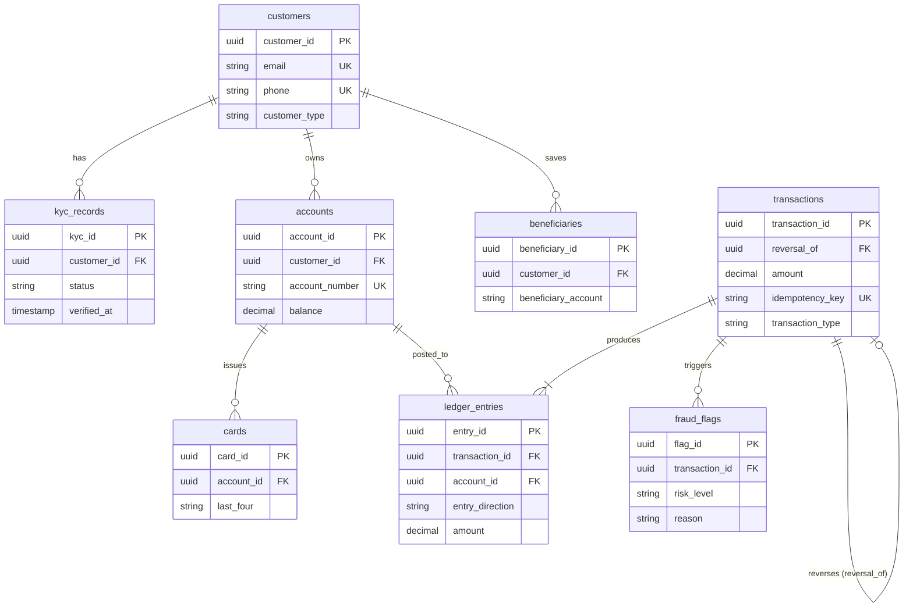

# QuickFund Case Study

## 1. Organisation and System Overview

QuickFund is a simulated Nigerian fintech company that provides digital wallet and money transfer services to individuals and small businesses.

The platform allows customers to create naira accounts, deposit and withdraw money, transfer funds to other wallets or bank accounts, pay bills and buy airtime, and view their transaction history.

### Database Users
- **Customers**: Individuals and merchants who use the platform.
- **Customer Support Staff**: Help customers resolve account and transaction issues.
- **Compliance and Audit Officers**: Verify customer identities, review transactions, and investigate suspicious activities.
- **System Services**: Process payments, send notifications, and generate financial reports.

### Major Data Stored
- Customer information and KYC verification records.
- Wallet accounts and balances.
- Transactions and double-entry ledger records.
- Saved beneficiaries and recipients.
- Card details and linked bank accounts.
- Fraud alerts and suspicious transaction flags.

### Key Operations
- Register customers and verify their identities.
- Deposit and withdraw funds.
- Transfer money between accounts.
- Reverse failed transactions while preserving transaction history.
- Generate account statements.
- Audit account balances.
- Identify and flag suspicious transactions.

### Technology Choices
- **PostgreSQL**: Stores financial transactions and ledger entries because it supports reliable transactions and strong ACID guarantees.
- **MongoDB**: To store audit logs and KYC documents with flexible data structures.
- **Docker Compose**: Runs and connects the database services in a controlled environment for the distributed systems exercise.

---

## 2. Business Rules

Business rules define how QuickFund operates and help enforce data accuracy, security, and consistency.

1. **Unique Credentials**: Every customer must have a unique email address and phone number.
2. **Customer Classification**: Every customer must be classified as either an `INDIVIDUAL` or a `MERCHANT`.
3. **Multiple KYC Submissions**: A customer can have multiple KYC verification records across tiers.
4. **KYC Verification Timestamp**: A KYC record can only have a verification timestamp when its status is no longer `PENDING`.
5. **Account Number & Non-Negative Balance**: Every wallet must have a non-negative balance and a unique account number consisting of exactly ten digits.
6. **Monetary Precision**: All monetary values must use exact decimal precision (`DECIMAL`/`NUMERIC`) rather than floating-point numbers.
7. **Idempotency & Positive Amounts**: Every transaction must have an amount greater than zero and a unique idempotency key to prevent duplicate processing.
8. **Reversal Constraint**: A transaction with type `REVERSAL` must reference the original transaction it reverses, while other transaction types must not reference an original transaction for reversal purposes.
9. **Ledger Integrity**: Every transaction must have ledger entries, and an account cannot appear more than once in the same direction (DEBIT/CREDIT) within a single transaction.
10. **Card Security (PCI-DSS)**: Only the last four digits of a payment card may be stored; the complete card number must never be stored.
11. **Immutability of Audit History**: Financial transaction and ledger records must be preserved when a customer or account is deleted (`ON DELETE RESTRICT` or soft deletion).
12. **Beneficiary Lifecycle**: A customer's saved beneficiaries must be deleted when that customer is deleted (`ON DELETE CASCADE`).
13. **Balanced Double-Entry**: A money transfer must maintain balanced ledger entries, where total debits equal total credits ($\sum \text{Debits} = \sum \text{Credits}$).
14. **Atomic Completion**: A transaction must not be marked as successful until its financial ledger entries have been recorded successfully.
15. **Access Control**: Only authorised personnel may access sensitive KYC information and financial audit records.

---

## 3. Identify Entities and Relationships

QuickFund uses eight core PostgreSQL tables to manage customer identity, wallet accounts, double-entry financial ledger operations, and fraud monitoring. Each entity serves a specific operational purpose and is bound through foreign key constraints that maintain relational integrity.

### Core Entity Catalog

| Entity (Table) | Purpose & Data Stored | Primary Key | Foreign Keys & Related Entities | Cardinality |
| :--- | :--- | :--- | :--- | :--- |
| **`customers`** | Core user profile data for individuals and registered merchants. | `customer_id` | Parent entity to `kyc_records`, `accounts`, and `beneficiaries`. | — |
| **`kyc_records`** | Customer identity verification submissions, document references, and verification status. | `kyc_id` | `customer_id` &rarr; `customers(customer_id)` | Many-to-One ($N:1$) |
| **`accounts`** | Wallet accounts, 10-digit account numbers, current balances, and status. | `account_id` | `customer_id` &rarr; `customers(customer_id)` | Many-to-One ($N:1$) |
| **`beneficiaries`** | Saved recipient accounts for quick repeat money transfers. | `beneficiary_id` | `customer_id` &rarr; `customers(customer_id)` | Many-to-One ($N:1$) |
| **`cards`** | Linked debit/virtual payment cards (stores token and last 4 digits only). | `card_id` | `account_id` &rarr; `accounts(account_id)` | Many-to-One ($N:1$) |
| **`transactions`** | High-level financial events (deposits, transfers, withdrawals, bill payments, reversals). | `transaction_id` | `reversal_of` &rarr; `transactions(transaction_id)` *(self-referencing)* | One-to-Many ($1:N$) self-reference |
| **`ledger_entries`** | Immutable double-entry bookkeeping records (debits and credits) that track money movement. | `entry_id` | `transaction_id` &rarr; `transactions(transaction_id)` `account_id` &rarr; `accounts(account_id)` | Many-to-One ($N:1$) to transactions Many-to-One ($N:1$) to accounts |
| **`fraud_flags`** | Automated alerts, anomaly detection signals, and compliance review flags. | `flag_id` | `transaction_id` &rarr; `transactions(transaction_id)` | Many-to-One ($N:1$) |

---

### Relationship Analysis

1. **`customers` &rarr; `kyc_records` ($1:N$)**: One customer can submit multiple identity verification records over time as they upgrade their account verification tiers.
2. **`customers` &rarr; `accounts` ($1:N$)**: One customer can own one or more wallet accounts (e.g., personal savings, merchant collection).
3. **`customers` &rarr; `beneficiaries` ($1:N$)**: One customer can store multiple favourite transfer recipients. Removing a customer cascades and deletes their saved beneficiaries.
4. **`accounts` &rarr; `cards` ($1:N$)**: An account can have multiple physical or virtual cards linked to its balance for payment operations.
5. **`transactions` &rarr; `ledger_entries` ($1:N$)**: Each transaction generates at least two immutable ledger entries (one debit and one credit) to guarantee balanced double-entry accounting.
6. **`accounts` &rarr; `ledger_entries` ($1:N$)**: An account's audit trail is composed of many ledger entries representing incoming and outgoing monetary flows.
7. **`transactions` &rarr; `transactions` ($0..1:1$)**: A recursive relationship via `reversal_of`. A reversal transaction points directly to the earlier transaction it undoes.
8. **`transactions` &rarr; `fraud_flags` ($1:N$)**: Suspicious transactions can trigger one or more fraud flags for audit and compliance inspection.

---

### Entity Relationship Diagram (ERD)

