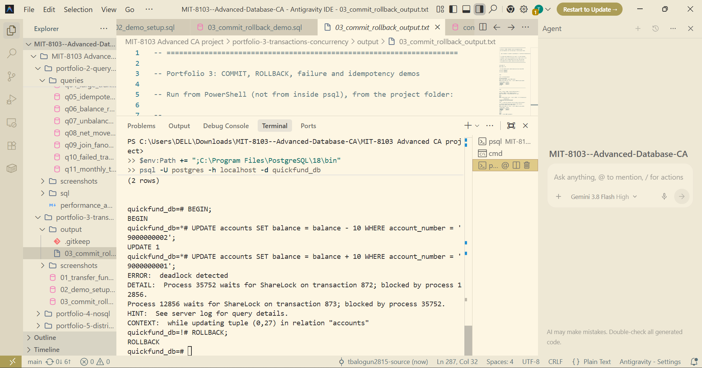
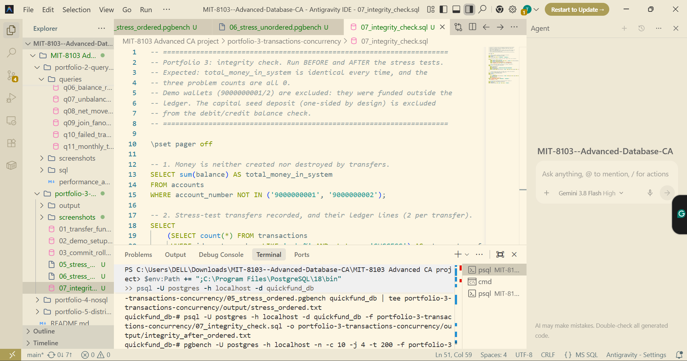
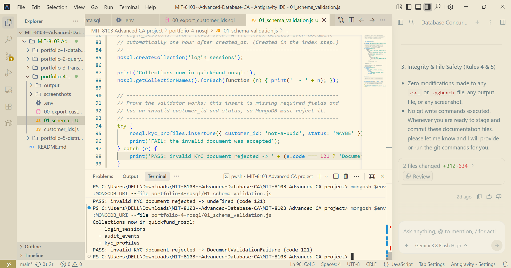
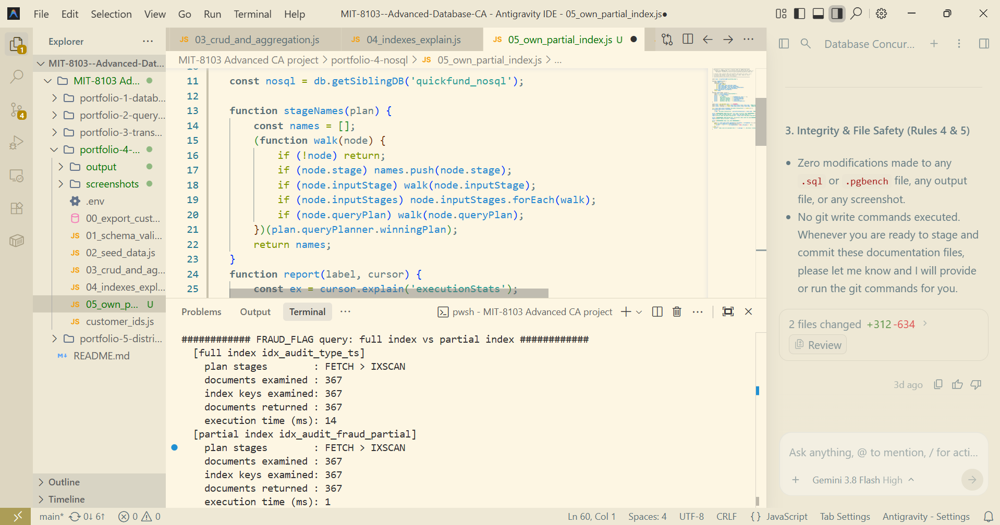
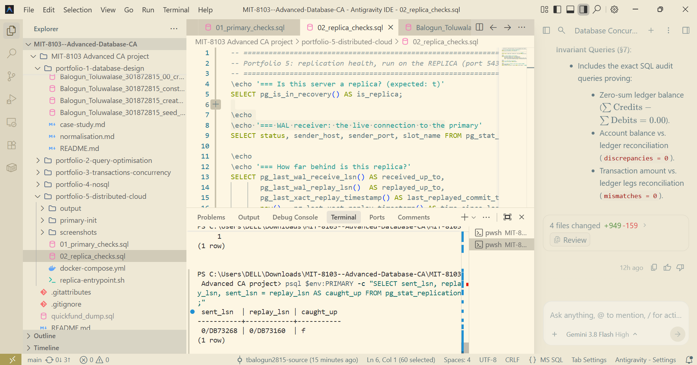
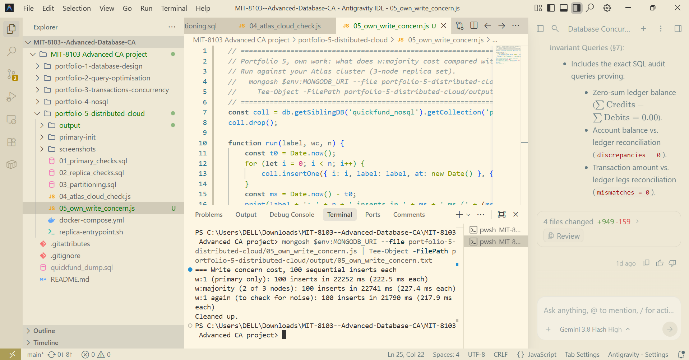

# MIT 8103: Advanced Database Systems — Continuous Assessment

**Student Name:** Balogun Toluwalase  
**Student ID:** 301872815  
**Course:** MIT 8103 Advanced Database Systems  
**Institution:** Miva Open University  
**Case Study:** QuickFund-Digital Wallet & Financial Ledger System  
**GitHub Repository:** https://github.com/tbalogun2815-source/MIT-8103--Advanced-Database-CA.git 

---

[Note: In this coursework, I build QuickFund, a digital wallet & financial ledger application. Throughout the coursework, I have tackled 5 different portfolios.]

## Portfolio 1: Database Design

I designed the QuickFund database using PostgreSQL. I identified key entities, and set up 8 relational tables using principles of normalisation & constraints to ensure accurate data. I wrote a script to generate thousands of sample entries and ran tests on the database to ensure adherence to 15 conditions (all passed).

Key Evidence:

- ER Diagram showing the 8 main relational entities within the database (`customers`, `kyc_records`, `accounts`, `beneficiaries`, `cards`, `transactions`, `ledger_entries`, `fraud_flags`). Also shows double entry ledger cardinalities.

- 15 Constraint tests, all passed (15/15 PASS). Showed that balance will always be greater than or equal to zero (`balance >= 0.00`), NUBAN numbers will always be 10 digits, PCI-DSS card masking & ensuring that only one reversal occurs.

## Portfolio 2: Query Optimisation

For this portfolio I wanted to understand how queries work within the database and how to optimise them. I wrote 11 SQL queries and ran EXPLAIN ANALYZE on them to understand how they operate. I then created 7 indexes and compared the results to understand how the indexes affect the speed of queries & database. For example, the account statement query speed improved from 22.80ms to 1.51ms by creating an index.

Key Evidence:

- Q1 Account Statement Query Plan. Showing how the speed was improved using indexes. From sequential scans on tables with 24,294 buffer hits, to index scans with 413 buffer hits (102.8x improvement, 98.3% less I/O).

- B-tree Indexes. Successfully created 7 indexes (composite & covering indexes created with the `INCLUDE` clause), to reduce the external merge spillage to up to 6.9MB.

## Portfolio 3: Transactions & Concurrency

Here I have looked at how to handle transactions for financial transactions (without causing issues with data integrity). Transaction control, row level locks & idempotent checks. I ran tests on the isolation levels and demonstrated how inconsistencies can occur with locking leading to deadlocks. Finally I ran integrity tests and found there were no unbalanced transactions and there was a ₦10 Billion balance.

Key Evidence:

- Deadlock Detection. Demonstrated how deadlock can occur with random locking. This caused PostgreSQL Deadlock Detection to kill process 35752. This was solved by applying canonical locking using the `LEAST` & `GREATEST` functions.

- Solvency & Integrity Check. After running tests involving concurrent activity (10 clients & 2000 transactions to 20 hot accounts). Verified that there were 0 unbalanced transactions. The system has a perfect 100% balance of ₦10,000,000,000.00.

## Portfolio 4: NoSQL & Advanced Data Modelling

I used MongoDB to compliment PostgreSQL. Each database holds different information (PostgreSQL for financial data, MongoDB for KYC profiles & audit events). I performed several tasks with the document modelling including document validation, CRUD functions & aggregation pipelines. I also performed some experimentation with creating a partial index which reduced the index size by 93.5%.

Key Evidence:

- Enforced Validation. Used JSON Schema Validation which enforces structure, UUID format & enum status. Invalid documents were rejected immediately with error code 121 (DocumentValidationFailure).

- Partial Index. Created a partial index on FRAUD_FLAG events which reduced the index size to just 72KB compared to 1,112KB (93.5% reduction in space). With 1ms query speeds.

## Portfolio 5: Distributed & Cloud Databases

For the final portfolio I set up Streaming Replication using PostgreSQL & Docker. I tested how the databases work on multiple nodes (replication lag, failover, partitioning & consistency). I also set up a 3 node MongoDB Atlas replica set and tested how write concerns affect performance.

Key Evidence:

- Asynchronous Replication. Demonstrated replication lag by stopping WAL (Write Ahead Logging) replay on the standby. This resulted in `caught_up = false`. `sent_lsn 0/DB73268` vs `replay_lsn 0/DB73160`. This shows why reads after transactions shouldn’t be performed on un-replicated replicas.

- MongoDB Atlas Write Concern. Compared `w: 1` to `w: majority`. When inserting 100 sequential insertions to AWS Paris (`eu-west-3`). `w: 1` took 222.5ms, `w: majority` took 227.4ms. This proves that latency between wide area networks completely overrides any quorum consensus overheads with local datacentres.

## Final Submission

The final coursework consists of 5 portfolios containing the implementation scripts, technical explanations, results & screenshots from experiments. The coursework also contains an Executive Engineering Report, AI Use Declaration & Bibliography containing 20 references.

All resources are located within the submission folder: [Balogun_Toluwalase_301872815/](Balogun_Toluwalase_301872815/).

- Executive Engineering Report: [Balogun_Toluwalase_301872815/Balogun_Toluwalase_301872815_Final_Report.md](Balogun_Toluwalase_301872815/Balogun_Toluwalase_301872815_Final_Report.md)

- AI Use Declaration: [Balogun_Toluwalase_301872815/Balogun_Toluwalase_AI_Use_Declaration.md](Balogun_Toluwalase_301872815/Balogun_Toluwalase_AI_Use_Declaration.md)

- Academic Reference & Bibliography (20 References): [Balogun_Toluwalase_301872815/Balogun_Toluwalase_301872815_References.md](Balogun_Toluwalase_301872815/Balogun_Toluwalase_301872815_References.md)

- Portfolio 1 - Database Design: [Balogun_Toluwalase_301872815/portfolio-1-database-design/](Balogun_Toluwalase_301872815/portfolio-1-database-design/README.md)

- Portfolio 2 - Query Optimisation: [Balogun_Toluwalase_301872815/portfolio-2-query-optimisation/](Balogun_Toluwalase_301872815/portfolio-2-query-optimisation/performance_analysis.md)

- Portfolio 3 - Transactions & Concurrency: [Balogun_Toluwalase_301872815/portfolio-3-transactions-concurrency/](Balogun_Toluwalase_301872815/portfolio-3-transactions-concurrency/README.md)

- Portfolio 4 - NoSQL: [Balogun_Toluwalase_301872815/portfolio-4-nosql/](Balogun_Toluwalase_301872815/portfolio-4-nosql/README.md)

- Portfolio 5 - Distributed & Cloud: [Balogun_Toluwalase_301872815/portfolio-5-distributed-cloud/](Balogun_Toluwalase_301872815/portfolio-5-distributed-cloud/README.md)

## Overall Reflection

This project helped me gain a better understanding of how database concepts apply to real world applications. I was able to move away from just writing SQL statements and understand how designing databases, indexes, transactions & replication can impact performance & reliability. Some of the experiments required some troubleshooting & adjustments. Overall this has given me a more practical understanding of database engineering.