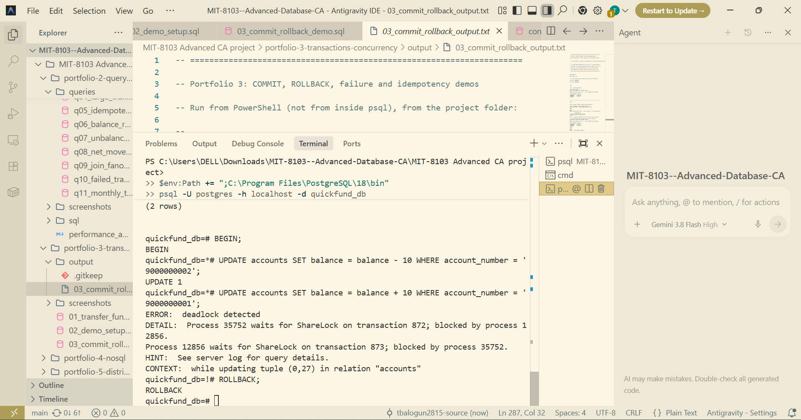
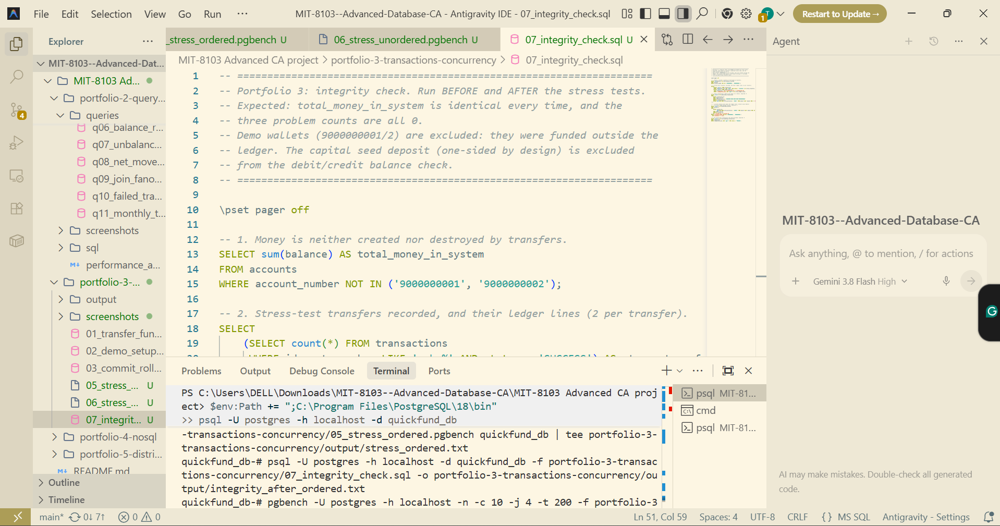
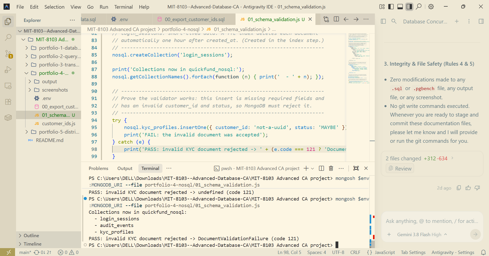
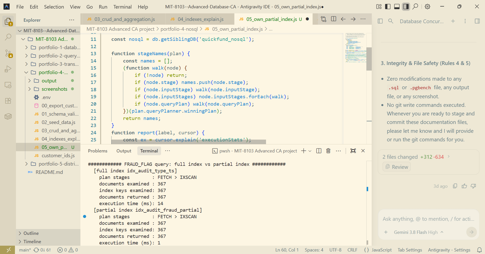
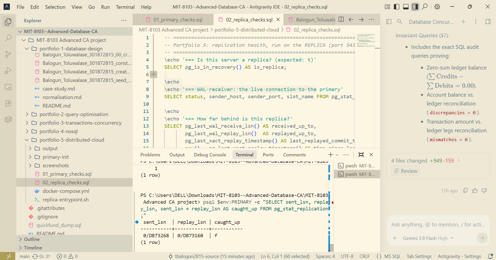
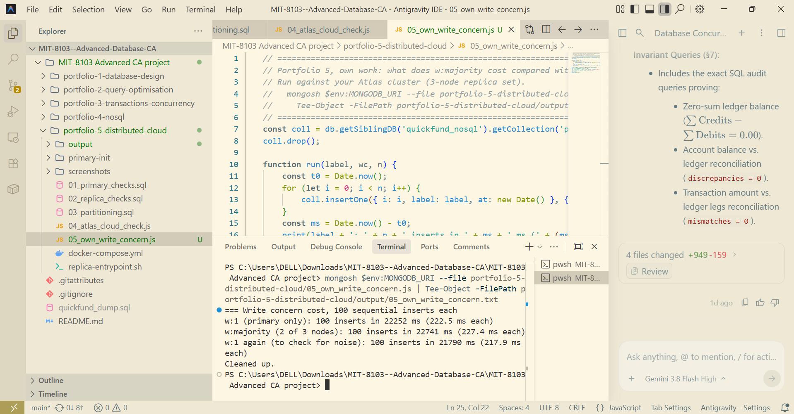

# MIT 8103: Advanced Database Systems — Continuous Assessment

**Student Name:** Balogun Toluwalase  
**Student ID:** 301872815  
**Course:** MIT 8103 Advanced Database Systems  
**Institution:** Miva Open University  
**Case Study:** QuickFund Digital Wallet & Financial Ledger System  
**GitHub Repository:** https://github.com/tbalogun2815-source/MIT-8103--Advanced-Database-CA.git 

---

In this coursework we built QuickFund (a digital wallet and financial ledger system) and applied database concepts to a real-world financial technology scenario. I went through five portfolios which covered different aspects of database development & management.

---

## Portfolio 1: Database Design and Modelling

I designed the QuickFund database in PostgreSQL first. I identified main entities, created eight relational tables, applied normalisation principles and constraints to ensure data accuracy; wrote a script to generate thousands of sample records and tested the database against 15 conditions (all passed).

### Key Evidence & Architecture
- **Entity-Relationship Diagram (ERD):** Demonstrating the 8 core relational entities (`customers`, `kyc_records`, `accounts`, `beneficiaries`, `cards`, `transactions`, `ledger_entries`, `fraud_flags`) and double-entry ledger cardinalities.
  
  

- **15 Automated Constraint Tests (15/15 PASS):** Proving non-negative balances (`balance >= 0.00`), 10-digit NUBAN formatting, PCI-DSS card masking, and single-reversal invariants at the PostgreSQL storage engine level.
  
  

---

## Portfolio 2: Query Optimisation and Performance Tuning

For this portfolio I wanted to see how database queries behave and what can be done to improve them. I wrote 11 SQL queries, EXPLAIN ANALYZE’d them (to see execution plans), created seven indexes and compared the results before and after optimisation (so I could see how indexing affects query speed and database resources). One example was that account statement query went from 22.80 ms to 1.51 ms by indexing it.

### Key Evidence & Performance Tuning
- **Execution Plan Analysis (Q1 Account Statement):** Transitioning from unindexed sequential table scans with 24,294 buffer page hits down to an index scan with 413 buffer hits (**102.8× speedup**, **98.3% I/O reduction**).
  
  

- **Targeted B-Tree Index Migration:** Successful creation of 7 composite and covering indexes with `INCLUDE` clauses, eliminating up to 6.9 MB external merge disk spills on analytical sort queries.
  
  

---

## Portfolio 3: Transactions and Concurrency

In this section I looked at how to do financial transactions without breaking data integrity (multiple operations can happen at the same time) — transaction controls, row level locking and idempotency checks; tested isolation levels; showed how inconsistent locking can cause deadlocks. Final integrity checks showed no unbalanced transactions and that system had ₦10 billion balance.

### Key Evidence & Concurrency Controls
- **Deadlock Detection under Unordered Locking:** Demonstrating how arbitrary row lock acquisition order causes mutual circular wait dependencies, prompting PostgreSQL's deadlock detector to terminate process 35752. This was resolved with canonical `LEAST`/`GREATEST` lock ordering.
  
  

- **System-Wide Solvency & Integrity Audit:** Automated verification after concurrent stress testing (10 clients, 2,000 transactions across 20 hot accounts) confirming zero unbalanced transactions and 100% mathematical balance preservation at ₦10,000,000,000.00.
  
  

---

## Portfolio 4: NoSQL and Advanced Data Models

I introduced MongoDB as a complement to PostgreSQL — each database had its own type of information (PostgreSQL was used for core financial records, MongoDB KYC profiles and audit events). Document validation, CRUD operations, aggregation pipelines etc. were all part of what I did with document manipulation in MongoDB. One experiment I ran was to create a partial index which required 93.5% less storage than the full index.

### Key Evidence & Document Modeling
- **Strict JSON Schema Validation:** Enforcing structural rules, UUID format, and enum statuses at the MongoDB engine level with immediate rejection (`DocumentValidationFailure`, code 121) of invalid records.
  
  

- **Partial Index Optimization:** A partial index on `FRAUD_FLAG` events consuming only 72 KB compared to 1,112 KB for the full index (**93.5% storage reduction**) while achieving 1 ms query response times.
  
  

---

## Portfolio 5: Distributed and Cloud Databases

For the final portfolio I set up PostgreSQL streaming replication with Docker and tested how databases behave on multiple nodes (replication delays, failover, partitioning, consistency etc.). I also deployed a three node MongoDB Atlas replica set and compared write concern settings to see how performance changes with different write concern settings.

### Key Evidence & Distributed Systems
- **Asynchronous Replication Stale-Read Hazard:** Demonstrating replication lag when standby WAL replay is paused (`caught_up = false`, `sent_lsn 0/DB73268` vs `replay_lsn 0/DB73160`), visually proving why financial post-transfer reads must not be routed to un-replicated replicas.
  
  

- **MongoDB Atlas Cloud Write Concern Benchmark:** Comparing `w: 1` (222.5 ms) against `w: majority` (227.4 ms) across 100 sequential inserts to AWS Paris (`eu-west-3`), proving that wide-area network latency completely dominates over local datacenter quorum consensus overhead.
  
  

---

## Final Submission

The final coursework is made up of the five portfolios (implementation scripts, technical explanations, test results and screenshots of experiments), executive engineering report, academic AI assistance declaration and bibliography (20 references).

All submission materials are organized inside the submission directory: [`Balogun_Toluwalase_301872815/`](Balogun_Toluwalase_301872815/):
- **Executive Engineering Report:** [`Balogun_Toluwalase_301872815/Balogun_Toluwalase_301872815_Final_Report.md`](Balogun_Toluwalase_301872815/Balogun_Toluwalase_301872815_Final_Report.md)
- **Academic AI Assistance Declaration:** [`Balogun_Toluwalase_301872815/Balogun_Toluwalase_AI_Use_Declaration.md`](Balogun_Toluwalase_301872815/Balogun_Toluwalase_AI_Use_Declaration.md)
- **Academic References & Bibliography (20 References):** [`Balogun_Toluwalase_301872815/Balogun_Toluwalase_301872815_References.md`](Balogun_Toluwalase_301872815/Balogun_Toluwalase_301872815_References.md)
- **Portfolio 1 (Database Design):** [`Balogun_Toluwalase_301872815/portfolio-1-database-design/`](Balogun_Toluwalase_301872815/portfolio-1-database-design/README.md)
- **Portfolio 2 (Query Optimisation):** [`Balogun_Toluwalase_301872815/portfolio-2-query-optimisation/`](Balogun_Toluwalase_301872815/portfolio-2-query-optimisation/performance_analysis.md)
- **Portfolio 3 (Transactions & Concurrency):** [`Balogun_Toluwalase_301872815/portfolio-3-transactions-concurrency/`](Balogun_Toluwalase_301872815/portfolio-3-transactions-concurrency/README.md)
- **Portfolio 4 (NoSQL):** [`Balogun_Toluwalase_301872815/portfolio-4-nosql/`](Balogun_Toluwalase_301872815/portfolio-4-nosql/README.md)
- **Portfolio 5 (Distributed & Cloud):** [`Balogun_Toluwalase_301872815/portfolio-5-distributed-cloud/`](Balogun_Toluwalase_301872815/portfolio-5-distributed-cloud/README.md)

---

## Overall Reflection

Working on this project helped me understand how database concepts translate to real world applications. I could move away from writing SQL statements and actually see how database design, indexing, transaction controls and replication impact system performance and reliability. Some of the experiments also needed troubleshooting and adjustments before I got what I expected. Overall it gave me a more practical understanding of database engineering and considerations for building a reliable financial system.
